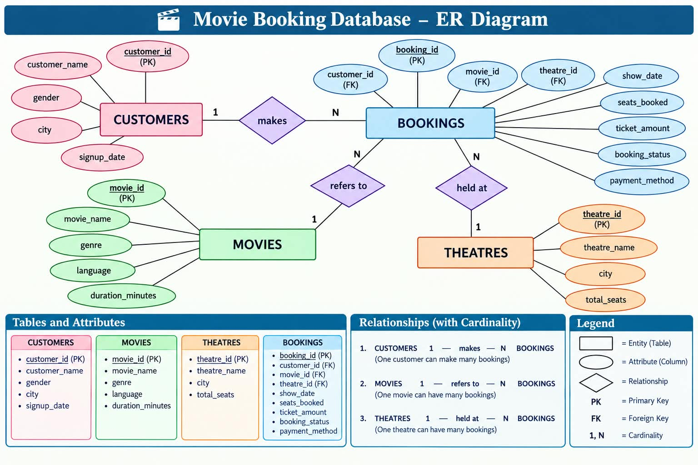

# 🎬 Movie Ticket Booking System — MySQL SQL Project

A MySQL-based relational database project for managing customers, movies, theatres, and movie ticket bookings.

This project demonstrates practical SQL skills through relational database design, primary keys, foreign keys, constraints, data analysis, JOINs, aggregate functions, subqueries, Common Table Expressions (CTEs), and window functions.

## 🚀 Project Highlights

- **Database:** `movie_booking_db`
- **Tables:** 4
- **SQL Queries:** 60
- **Query Levels:** Simple, Medium, and Hard
- **Tools:** MySQL, MySQL Workbench, MySQL CLI, Git, and GitHub

---

## 📌 Project Overview

The Movie Ticket Booking System models a basic movie-ticket booking workflow using a relational database.

The database contains four main entities:

- 👤 **Customers** — Stores customer details.
- 🎬 **Movies** — Stores movie information.
- 🏢 **Theatres** — Stores theatre details and seating capacity.
- 🎟️ **Bookings** — Stores ticket booking information and connects customers, movies, and theatres.

The `bookings` table serves as the central table and connects the other three tables through foreign-key relationships.

The project progresses from basic SQL queries to advanced database analysis and business-oriented questions.

---

## 🎯 Project Objectives

The main objectives of this project are to:

- Design and implement a relational database using MySQL.
- Create related tables with appropriate primary keys and foreign keys.
- Maintain referential integrity between related tables.
- Store customer, movie, theatre, and booking information.
- Practice SQL data retrieval, filtering, sorting, and aggregation.
- Perform multi-table analysis using JOINs.
- Use `GROUP BY` and `HAVING` to analyze grouped data.
- Write nested and correlated subqueries.
- Practice CTEs and window functions.
- Analyze booking activity, ticket amounts, customer activity, and movie popularity.
- Strengthen practical SQL skills for academic projects and technical interviews.

---

## 🗄️ Database Structure

**Database Name:** `movie_booking_db`

The database contains four tables.

| Table | Purpose |
|---|---|
| `customers` | Stores customer information |
| `movies` | Stores movie information |
| `theatres` | Stores theatre information |
| `bookings` | Stores movie ticket booking information |

### 1. Customers Table

Stores information about customers registered in the system.

| Column | Description |
|---|---|
| `customer_id` | Unique customer identifier |
| `customer_name` | Customer name |
| `gender` | Customer gender |
| `city` | Customer city |
| `signup_date` | Customer registration date |

### 2. Movies Table

Stores information about movies available in the system.

| Column | Description |
|---|---|
| `movie_id` | Unique movie identifier |
| `movie_name` | Movie name |
| `genre` | Movie genre |
| `language` | Movie language |
| `duration_minutes` | Movie duration in minutes |

### 3. Theatres Table

Stores information about theatres.

| Column | Description |
|---|---|
| `theatre_id` | Unique theatre identifier |
| `theatre_name` | Theatre name |
| `city` | Theatre city |
| `total_seats` | Total theatre seating capacity |

### 4. Bookings Table

Stores booking information and links customers, movies, and theatres.

| Column | Description |
|---|---|
| `booking_id` | Unique booking identifier |
| `customer_id` | Reference to the customer |
| `movie_id` | Reference to the movie |
| `theatre_id` | Reference to the theatre |
| `show_date` | Movie show date and time |
| `seats_booked` | Number of seats booked |
| `ticket_amount` | Booking ticket amount |
| `booking_status` | Booking status |
| `payment_method` | Payment method |

---

## 🔗 ER Diagram & Database Relationships

The Entity Relationship Diagram (ERD) illustrates the database structure, table attributes, and relationships between the four tables.

<p align="center">
  
</p>

### Primary Relationships

| Relationship | Cardinality | Description |
|---|---|---|
| Customers → Bookings | 1 : N | One customer can have multiple bookings. |
| Movies → Bookings | 1 : N | One movie can appear in multiple bookings. |
| Theatres → Bookings | 1 : N | One theatre can be associated with multiple bookings. |

### Foreign-Key Relationships

The `bookings` table contains the following foreign keys:

- `bookings.customer_id` → `customers.customer_id`
- `bookings.movie_id` → `movies.movie_id`
- `bookings.theatre_id` → `theatres.theatre_id`

These relationships help maintain consistency between bookings and their associated customers, movies, and theatres.

---

## 🛠️ Technologies Used

| Technology / Tool | Purpose |
|---|---|
| **MySQL** | Relational database management |
| **SQL** | Database creation, querying, and analysis |
| **MySQL Workbench** | Writing and executing SQL queries |
| **MySQL CLI** | Restoring databases and executing SQL from the command line |
| **Git** | Version control |
| **GitHub** | Project hosting and source-code management |

---

## 📊 SQL Analysis — 60 Queries

The project contains **60 SQL practice queries**, organized into three difficulty levels with 20 queries in each level.

### 🟢 Simple Queries — 20 Queries

Focuses on fundamental SQL operations and data retrieval.

Topics include:

- `SELECT`
- `WHERE`
- `LIKE`
- `BETWEEN`
- `ORDER BY`
- `LIMIT`
- `DISTINCT`
- `COUNT()`
- `SUM()`
- `AVG()`
- `MIN()` and `MAX()`
- String functions
- Date functions
- Basic filtering and sorting

**File:** `Simple_queries.txt`

### 🟡 Medium Queries — 20 Queries

Focuses on relational data analysis and combining information from multiple tables.

Topics include:

- `INNER JOIN`
- `LEFT JOIN`
- `RIGHT JOIN`
- `CROSS JOIN`
- `GROUP BY`
- `HAVING`
- Aggregate functions
- `CASE` expressions
- Subqueries
- Multi-table analysis

**File:** `Medium_queries.txt`

### 🔴 Hard Queries — 20 Queries

Focuses on advanced SQL techniques and more complex analytical problems.

Topics include:

- Nested subqueries
- Correlated subqueries
- Common Table Expressions (CTEs)
- Window functions
- `RANK()`
- `DENSE_RANK()`
- `ROW_NUMBER()`
- `PARTITION BY`
- Complex aggregations
- Business-oriented analysis

**File:** `Hard_queries.txt`

### Recommended Learning Order

```text
Simple Queries
      ↓
Medium Queries
      ↓
Hard Queries
```

This progression helps build a foundation in SQL before moving to more advanced queries.

---

## 💼 Business Questions Explored

The SQL queries can be used to investigate practical questions such as:

- Which movies have the most bookings?
- Which customers have made the most bookings?
- Which theatres receive the most bookings?
- What is the total ticket amount across bookings?
- What is the average booking amount?
- Which movies have the highest ticket amounts?
- Which cities have the most customers?
- Which payment methods are used most frequently?
- How many seats have been booked for each movie?
- Which theatres have the highest booking activity?
- Which customers have never made a booking?
- Which movies have no associated bookings?
- What is the average number of seats per booking?
- Which bookings have the highest ticket amounts?
- How does booking activity vary by date?

These questions demonstrate how SQL can be used to transform relational data into useful information for analysis and decision-making.

---

## 📁 Repository Structure

```text
MySQL-Codegnan-Project/
│
├── README.md
├── movie_booking.sql
├── Database_Restore_Guide.txt
├── Execution.txt
├── Simple_queries.txt
├── Medium_queries.txt
├── Hard_queries.txt
└── ER-Diagram.png
```

### File Descriptions

| File | Description |
|---|---|
| `README.md` | Project overview, database documentation, and setup instructions |
| `movie_booking.sql` | Complete database dump containing table definitions and data for restoration |
| `Database_Restore_Guide.txt` | Instructions for creating and restoring the database |
| `Execution.txt` | Guide for setting up the database and executing the project |
| `Simple_queries.txt` | 20 basic SQL queries |
| `Medium_queries.txt` | 20 intermediate SQL queries |
| `Hard_queries.txt` | 20 advanced SQL queries |
| `ER-Diagram.png` | Visual representation of the database relationships |

**Recommended setup method:** Use `movie_booking.sql` to restore the complete database. The restore guide and execution guide provide supporting instructions, while the query files organize SQL practice by difficulty.

## 🚀 How to Run the Project

### Prerequisites

Before running the project, make sure you have:

- MySQL Server 8.0 or a compatible version.
- MySQL Workbench or the MySQL command-line client.
- Git, if you want to clone the repository.

### Step 1 — Clone the Repository

Open Command Prompt or a terminal and run:

```bash
git clone https://github.com/SaitrishankAUCSE/MySQL-Codegnan-Project.git
cd MySQL-Codegnan-Project
```

Alternatively, download the repository as a ZIP file from GitHub and extract it.

### Step 2 — Create the Database

Open MySQL Workbench, create a new SQL tab, and execute:

```sql
CREATE DATABASE IF NOT EXISTS movie_booking_db;
```

This creates the database if it does not already exist.

### Step 3 — Restore the Database

Open Command Prompt in the project directory containing `movie_booking.sql` and execute:

```cmd
mysql -u root -p movie_booking_db < movie_booking.sql
```

Enter your MySQL password when prompted.

**Windows troubleshooting:** If `mysql` is not recognized as a command, use the full path to your MySQL client:

```cmd
"C:\Program Files\MySQL\MySQL Server 8.0\bin\mysql.exe" -u root -p movie_booking_db < movie_booking.sql
```

Adjust the path if MySQL is installed in a different directory.

**Important:** The dump recreates project tables with the same names. Back up any existing data in those tables before restoring over a database that contains information you need to keep.

For additional instructions, see `Database_Restore_Guide.txt` and `Execution.txt`.

### Step 4 — Verify the Database

Open MySQL Workbench or the MySQL CLI and run:

```sql
USE movie_booking_db;

SHOW TABLES;
```

The database should contain these four tables:

```text
customers
movies
theatres
bookings
```

### Step 5 — Verify the Records

Execute the following queries:

```sql
SELECT COUNT(*) AS total_customers
FROM customers;

SELECT COUNT(*) AS total_movies
FROM movies;

SELECT COUNT(*) AS total_theatres
FROM theatres;

SELECT COUNT(*) AS total_bookings
FROM bookings;
```

The verified dataset contains:

| Table | Expected Records |
|---|---:|
| `customers` | 20,000 |
| `movies` | 500 |
| `theatres` | 200 |
| `bookings` | 20,000 |
| **Total** | **40,700** |

### Step 6 — Inspect Sample Records

Use `LIMIT` to preview data without displaying every row:

```sql
SELECT * FROM customers LIMIT 10;

SELECT * FROM movies LIMIT 10;

SELECT * FROM theatres LIMIT 10;

SELECT * FROM bookings LIMIT 10;
```

### Step 7 — Execute the SQL Queries

Open the corresponding query file in a text editor or MySQL Workbench, then execute its SQL statements against `movie_booking_db`.

Run the files in this order:

1. `Simple_queries.txt`
2. `Medium_queries.txt`
3. `Hard_queries.txt`

Make sure you have selected the correct database before executing the queries.

---

## 🎓 Learning Outcomes

This project provides practical experience with:

- Relational database design
- Database and table creation
- Primary keys and foreign keys
- One-to-many relationships
- Referential integrity
- CRUD operations
- SQL constraints
- Data filtering and sorting
- Aggregate functions
- JOINs and multi-table queries
- `GROUP BY` and `HAVING`
- Subqueries and correlated subqueries
- Common Table Expressions (CTEs)
- Window functions and ranking
- SQL-based business analysis

---

## 🔮 Possible Future Improvements

The database could be extended with additional functionality, including:

- Individual movie show schedules
- Theatre screens and seat-level management
- Ticket pricing by seat type
- Offers and discounts
- Booking cancellation and refund tracking
- Movie reviews and ratings
- Food and beverage orders
- Detailed online payment transactions
- Theatre-wise seat occupancy analysis

These enhancements would expand the database toward a more comprehensive movie-ticket booking application.

---

## 👨‍💻 Project Summary

The **Movie Ticket Booking System** is a practical MySQL project that models customers, movies, theatres, and bookings using a connected relational database.

It combines database design, referential integrity, and 60 SQL queries across three difficulty levels. The project provides hands-on practice with fundamental and advanced SQL concepts while exploring business-oriented questions involving bookings, customers, movies, theatres, and ticket amounts.

The repository includes the SQL database dump, query files, restore guide, execution guide, and ER diagram to make the project easier to understand, restore, and explore.

---

## ⭐ Skills Demonstrated

**MySQL · SQL · Relational Database Design · Primary Keys · Foreign Keys · Referential Integrity · Joins · Aggregation · Subqueries · CTEs · Window Functions · Data Analysis · Database Management**
